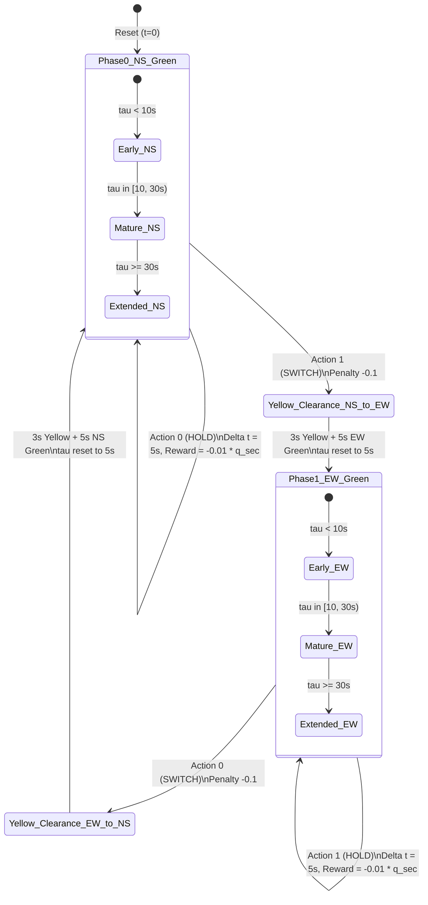
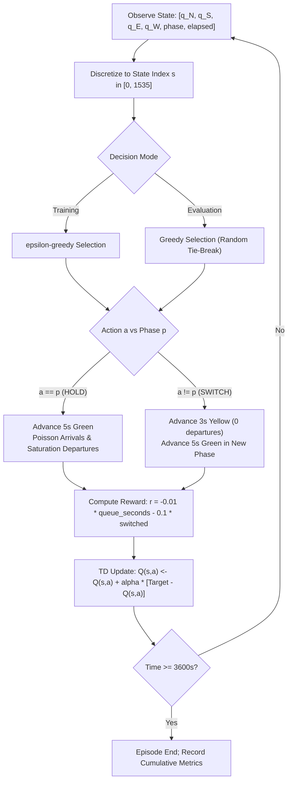

# Fundamentals of Reinforcement Learning: 10-Point Assignment Submission

This document provides a self-contained, point-by-point response to all **10 items** required for the Fundamentals of Reinforcement Learning coursework assignment.

**Project Title:** Adaptive Traffic Signal Control at an Isolated Four-Way Intersection  
**Repository:** `Advance-Adaptive-Traffic-Signal-Control`  
**Live Interactive Demo:** [Streamlit Cloud Deployment](https://adaptive-traffic-signal-control-8x5zgibkmr432uaitwwtf7.streamlit.app)  

---

## Item 1: Select a real-world sequential decision-making problem suitable for Reinforcement Learning

### Selected Problem
**Adaptive Traffic Signal Control (ATSC)** at an isolated four-way urban intersection (North, South, East, West) with single-lane approaches, subject to dynamic, stochastic, and asymmetric traffic demands.

### Why This Problem is Suitable for Reinforcement Learning
1. **Sequential Nature with Delayed Consequences:** Decisions made now (holding green vs. switching phase) directly influence queues and delays far into the future. Holding a green light clears current vehicles but causes cumulative queues to swell exponentially on the perpendicular cross-street.
2. **Dynamic Trade-offs (Lost Time vs. Queues):** Switching phases incurs a mandatory safety clearance delay (**3 seconds of yellow lost time**), during which departures halt on all approaches while arrivals continue. The controller must balance the cost of switching (lost capacity) against the cost of holding (cross-street starvation).
3. **Non-Stationary Stochastic Environment:** Vehicle arrivals follow stochastic Poisson distributions whose rates change across time-of-day windows (morning peak, midday lull, evening peak). Pre-timed controllers fail under demand shifts because their fixed splits cannot adapt.
4. **Closed-Loop Feedback:** Unlike open-loop heuristics, an RL agent perceives current queue states, receives feedback through delay penalties, and autonomously learns an optimal long-term policy without requiring manual retuning or prior knowledge of future arrivals.

---

## Item 2: Identify the agent, environment, states, actions, goals and rewards for the selected problem

| Element | Specification & Operational Definition |
|---|---|
| **Agent** | The traffic signal controller executing at the intersection, selecting the active phase every 5 seconds. |
| **Environment** | The 4-way intersection (`SimpleTrafficEnv`), encompassing approaching queues (N, S, E, W), Poisson arrivals, saturation flow departures (0.5 veh/s), yellow lost time (3s), and signal state. |
| **States ($S_t$)** | Continuous: $[q_N, q_S, q_E, q_W, \text{phase}, \text{elapsed}] \in \mathbb{R}^6$.<br>Discrete: Discretized into **1536 finite states** via binning ($4^4 \text{ queues} \times 2 \text{ phases} \times 3 \text{ elapsed bins}$). |
| **Actions ($A_t$)** | Discrete action space $\mathcal{A} = \{0, 1\}$:<br>• $a=0$: Phase 0 (North-South Green, East-West Red)<br>• $a=1$: Phase 1 (East-West Green, North-South Red)<br>Selecting current phase = **HOLD** (5s green); selecting opposite phase = **SWITCH** (3s yellow + 5s green). |
| **Goals** | Minimize average delay per vehicle, prevent approach starvation, maximize throughput, and eliminate erratic signal flickering. |
| **Rewards ($R_t$)** | Scalar reward feedback at each decision step:<br>$$r_t = -0.01 \cdot (\text{queue-seconds}) - 0.1 \cdot \mathbb{I}(\text{switched})$$<br>Directly minimizes total cumulative vehicle waiting time (delay). |

### Mathematical Reward Alignment
In transportation engineering, the total delay across an evaluation period of $T$ seconds is the integral of queued vehicles:
$$D = \sum_{t=1}^T \sum_{i \in \{N,S,E,W\}} q_i(t) \quad \text{[queue-seconds]}$$
Maximizing cumulative undiscounted return $\sum_t R_{t+1} = \sum_t \left( -0.01 \cdot \text{delay}_t - 0.1 \cdot \text{switch}_t \right)$ directly minimizes total delay $D$, while the minor penalty ($0.10 \approx 10$ queue-seconds) discourages unnecessary switching.

---

## Item 3: Model the problem as a Finite Markov Decision Process (MDP)

The decision problem is formalized as a stationary 5-tuple:
$$\mathcal{M} = \langle \mathcal{S}, \mathcal{A}, \mathcal{P}, \mathcal{R}, \gamma \rangle$$

### 1. Finite State Space $\mathcal{S}$
A continuous observation $\mathbf{x} = [q_N, q_S, q_E, q_W, p, \tau]$ is mapped to a discrete state index via binning:
- **Queue Bins per approach (4 bins each):**
  - Bin 0: $0 \le q < 3$ (light / clearing)
  - Bin 1: $3 \le q < 7$ (moderate)
  - Bin 2: $7 \le q < 13$ (heavy)
  - Bin 3: $q \ge 13$ (saturated)
- **Phase Bins (2 bins):** Bin 0 (NS Green), Bin 1 (EW Green).
- **Elapsed Green Bins (3 bins):**
  - Bin 0: $\tau < 10\text{s}$ (recent switch, protected minimum green)
  - Bin 1: $10\text{s} \le \tau < 30\text{s}$ (mature green)
  - Bin 2: $\tau \ge 30\text{s}$ (extended green, cross-street delay accumulating)
- **Total Discrete States:**
  $$|\mathcal{S}| = 4 \times 4 \times 4 \times 4 \times 2 \times 3 = 1536 \text{ states}$$

### 2. Action Space $\mathcal{A}$
$$\mathcal{A} = \{0, 1\}$$
- Action 0: NS Green / EW Red.
- Action 1: EW Green / NS Red.

### 3. Transition Probability Function $\mathcal{P}(s' \mid s, a)$
Queue lengths evolve according to:
$$q_i(t+1) = \max\left(0, q_i(t) + A_i(t) - D_i(t)\right)$$
where:
- **Arrivals $A_i(t) \sim \text{Poisson}(\lambda_i \Delta t)$:** Memoryless Poisson distribution with arrival rate $\lambda_i$.
- **Departures $D_i(t)$:** Binomial discharge with probability $p = 0.5$ per second if approach $i$ is green and queue $> 0$ (1800 veh/h saturation flow from Highway Capacity Manual). During red and yellow intervals, departures are 0.
- **Elapsed Green Progression:** Resets to 5s upon a switch (after 3s yellow); increments by 5s upon a hold.

### 4. Markov Property Justification
The state vector $\mathbf{s}_t = (q_N, q_S, q_E, q_W, p, \tau)$ satisfies the Markov property:
$$\mathbb{P}(S_{t+1} = s', R_{t+1} = r \mid S_t, A_t, S_{t-1}, A_{t-1}, \dots, S_0, A_0) = \mathbb{P}(S_{t+1} = s', R_{t+1} = r \mid S_t, A_t)$$
Because Poisson arrivals are memoryless and departures depend strictly on current queue lengths and signal indications, knowing the history of past signal states provides zero additional information about future transitions.

### 5. Discount Factor $\gamma = 0.95$
Provides an effective horizon of $H_{\text{eff}} = \frac{1}{1 - \gamma} = 20$ decisions ($\approx 100\text{--}160\text{s}$ of simulated time), spanning approximately 2 complete signal cycles.

---

## Item 4: Define the episodes, returns, policy and value function for the selected problem

### 1. Episodes
- **Horizon:** Episodic task spanning $1\text{ simulated hour} = 3600\text{ seconds}$.
- **Decisions per Episode:** $600\text{--}720$ sequential decision epochs.
- **Termination:** Truncated at $t = 3600\text{s}$ (`truncated = True`, `terminated = False`).

### 2. Returns
The discounted return $G_t$ from time step $t$ is:
$$G_t = \sum_{k=0}^{T-t-1} \gamma^k R_{t+k+1}$$
where $R_{t+k+1} = -0.01 \cdot (\text{queue\_seconds}) - 0.1 \cdot \mathbb{I}(\text{switched})$.

### 3. Policy $\pi(a \mid s)$
- **Exploration Policy ($\epsilon$-greedy during training):**
  $$\pi(a \mid s) = \begin{cases} 1 - \epsilon + \frac{\epsilon}{|\mathcal{A}|} & \text{if } a = \arg\max_{a'} Q(s, a') \\ \frac{\epsilon}{|\mathcal{A}|} & \text{otherwise} \end{cases}$$
  with $\epsilon$ decaying linearly from $1.0 \to 0.05$ across episodes 0–280.
- **Evaluation Policy (Greedy with Uniform Random Tie-Breaking):**
  $$\pi^*(s) = \arg\max_{a \in \mathcal{A}} Q(s, a) \quad (\text{ties broken uniformly at random})$$

### 4. Value Functions
- **State-Value Function $V^\pi(s)$:** Expected return starting from state $s$ under policy $\pi$:
  $$V^\pi(s) = \mathbb{E}_\pi \left[ \sum_{k=0}^\infty \gamma^k R_{t+k+1} \;\middle|\; S_t = s \right]$$
- **Action-Value Function $Q^\pi(s, a)$:** Expected return starting from state $s$, taking action $a$, and thereafter following policy $\pi$:
  $$Q^\pi(s, a) = \mathbb{E}_\pi \left[ R_{t+1} + \gamma V^\pi(S_{t+1}) \;\middle|\; S_t = s, A_t = a \right]$$
- **Optimal Value Functions:**
  $$V^*(s) = \max_\pi V^\pi(s), \quad Q^*(s, a) = \max_\pi Q^\pi(s, a)$$

---

## Item 5: Represent the MDP using suitable state-transition diagrams, tables, flowcharts or graphs

### 1. State-Transition Diagram (Mermaid)



### 2. Decision Flowchart (Mermaid)



### 3. State Discretization Mapping Table

| State Variable | Range | Bin Edges | Bins Count | Bin Labels |
|---|---|---|---|---|
| $q_N, q_S$ (North, South Queues) | $0\text{--}40$ veh | $[3, 7, 13]$ | 4 | Light ($<3$), Moderate ($3\text{--}6$), Heavy ($7\text{--}12$), Saturated ($\ge 13$) |
| $q_E, q_W$ (East, West Queues) | $0\text{--}40$ veh | $[3, 7, 13]$ | 4 | Light ($<3$), Moderate ($3\text{--}6$), Heavy ($7\text{--}12$), Saturated ($\ge 13$) |
| $p$ (Active Green Phase) | $\{0, 1\}$ | None | 2 | 0: NS Green / EW Red, 1: EW Green / NS Red |
| $\tau$ (Elapsed Green Time) | $0\text{--}120$ s | $[10, 30]$ | 3 | Early ($<10$s), Mature ($10\text{--}29$s), Extended ($\ge 30$s) |
| **Total Product** | — | — | **1536** | $4 \times 4 \times 4 \times 4 \times 2 \times 3 = 1536$ states |

### 4. Demand Regime Schedule

| Window (s) | Duration | N Rate | S Rate | E Rate | W Rate | Total Rate | Traffic Condition |
|---|---|---|---|---|---|---|---|
| 0 – 1200 | 20 min | 0.16 veh/s | 0.16 veh/s | 0.06 veh/s | 0.06 veh/s | 0.44 veh/s | North-South Heavy |
| 1200 – 2400 | 20 min | 0.11 veh/s | 0.11 veh/s | 0.11 veh/s | 0.11 veh/s | 0.44 veh/s | Balanced Traffic |
| 2400 – 3600 | 20 min | 0.06 veh/s | 0.06 veh/s | 0.16 veh/s | 0.16 veh/s | 0.44 veh/s | East-West Heavy |

---

## Item 6: Apply the Bellman equation to calculate and analyze the value of at least one state

### Theoretical Bellman Equations
- **Bellman Optimality Equation for $Q^*(s, a)$:**
  $$Q^*(s, a) = \sum_{s' \in \mathcal{S}} \mathcal{P}(s' \mid s, a) \left[ \mathcal{R}(s, a, s') + \gamma \max_{a' \in \mathcal{A}} Q^*(s', a') \right]$$
- **Bellman Optimality Equation for $V^*(s)$:**
  $$V^*(s) = \max_{a \in \mathcal{A}} Q^*(s, a)$$

### Concrete State Calculation
Consider the unbalanced intersection state $s_0$:
$$\mathbf{s}_0 = (q_N=2, \, q_S=2, \, q_E=8, \, q_W=8, \, p=0, \, \tau=15\text{s}) \quad \implies \quad \text{State Index } \mathbf{s_0 = 61}$$
- NS queues are low ($q_N=2, q_S=2 \in \text{Bin } 0$).
- EW queues are backed up ($q_E=8, q_W=8 \in \text{Bin } 2$).
- Active phase is NS Green ($p=0$).
- Elapsed green is mature ($\tau=15\text{s} \in \text{Bin } 1$).

#### Option A: Action 0 (HOLD NS Green)
- **Immediate Reward:** Over 5 seconds, NS queues empty (departures $\approx 2.0$), producing $\approx 10$ queue-seconds. Meanwhile, blocked EW queues continue accumulating arrivals, producing $\approx 82.2$ queue-seconds.
  $$\mathbb{E}[R_{t+1} \mid s_0, 0] = -0.01 \times (10 + 82.2) \approx \mathbf{-0.933}$$
- **Continuation Value:** The next state $S'$ has queues $(0, 0, 9, 9)$ with EW still blocked.
  $$\gamma \mathbb{E}[V^*(S') \mid s_0, 0] = 0.95 \times (-5.556) = \mathbf{-5.278}$$
- **Bellman RHS Value for HOLD:**
  $$Q^*(s_0, 0) = -0.933 + (-5.278) = \mathbf{-6.211}$$

#### Option B: Action 1 (SWITCH to EW Green)
- **Immediate Reward:** 3s yellow clearance (zero departures, queues persist) + 5s EW green (EW discharges $\approx 2.5$ veh/approach, reducing queues from 8 to 6) + switch penalty ($-0.10$). Total queue-seconds $\approx 160.8$.
  $$\mathbb{E}[R_{t+1} \mid s_0, 1] = -0.01 \times 160.8 - 0.10 \approx \mathbf{-1.708}$$
- **Continuation Value:** The next state $S'$ has queues $(3, 3, 6, 6)$ and active phase $p=1$ (EW Green). Because EW queues are actively discharging, future delay is drastically lower!
  $$\gamma \mathbb{E}[V^*(S') \mid s_0, 1] = 0.95 \times (-3.164) = \mathbf{-3.006}$$
- **Bellman RHS Value for SWITCH:**
  $$Q^*(s_0, 1) = -1.708 + (-3.006) = \mathbf{-4.714}$$

#### Conclusion & Policy Selection
$$Q^*(s_0, 1) = -4.714 > Q^*(s_0, 0) = -6.211$$
$$V^*(s_0) = \max(-6.211, -4.714) = \mathbf{-4.714}$$
$$\pi^*(s_0) = \arg\max_a Q^*(s_0, a) = \mathbf{1 \quad (\text{SWITCH to EW})}$$

**Analysis:** Despite a worse immediate reward due to the 3-second yellow penalty ($-1.708$ vs $-0.933$), the Bellman equation correctly proves that switching yields a substantially higher continuation value ($-3.006$ vs $-5.278$), successfully resolving the temporal trade-off.

---

## Item 7: Explain how the selected policy influences the agent's decisions

1. **Exploration Schedule ($\epsilon$-Greedy):**
   - High early exploration ($\epsilon = 1.0 \to 0.05$) forces the agent to experience high-delay states (e.g., queues $> 13$), teaching the Q-table the steep penalty of neglecting opposing traffic.
   - Smooth decay prevents premature convergence to suboptimal myopic policies.
2. **Tie-Breaking Mechanism (Deadlock Prevention):**
   - With 1536 states, ~64% remain unvisited under typical trajectories and have $Q(s, 0) = Q(s, 1) = 0$.
   - A deterministic `argmax` defaults to index 0 (HOLD NS). On test seed 1007, this trapped the controller in an infinite 40-minute hold, causing EW queues to reach 327 vehicles ($92.7$s average wait).
   - Uniform random tie-breaking switches the signal within 1–2 steps upon encountering unvisited states, steering the intersection back to known states and dropping delay to $12.7$s.
3. **Adaptive Phase Allocation Across Demand Windows:**
   - Adapts green time dynamically: holds green for 25–40s in the heavy direction, and 10–15s in the light direction.
   - Requires no explicit clock; policy decisions are guided entirely by real-time queue states and elapsed time.

---

## Item 8: Develop a simple prototype/demo to demonstrate the designed MDP and decision-making process

The project provides two interactive demonstration prototypes:

### 1. Dedicated Standalone MDP Prototype CLI (`src/traffic_rl/mdp_demo.py`)
Run from terminal:
```bash
python -m traffic_rl.mdp_demo --steps 6 --seed 42
```
Outputs step-by-step state decomposition, queue evolution, immediate rewards, and live Bellman action value calculations.

### 2. Interactive Web Application (`app/streamlit_app.py`)
Deployed live on Streamlit Community Cloud:  
👉 **[https://adaptive-traffic-signal-control-8x5zgibkmr432uaitwwtf7.streamlit.app](https://adaptive-traffic-signal-control-8x5zgibkmr432uaitwwtf7.streamlit.app)**  
Allows users to adjust arrival rates via sliders and witness side-by-side queue buildup comparing the RL agent against fixed timers.

---

## Item 9 (First 9): Prototype demonstration of state transitions, rewards, decisions, value calculations or simple simulation

The prototype implementation (`src/traffic_rl/mdp_demo.py`) explicitly demonstrates:
1. **State Transitions:** Decomposes continuous queues and elapsed green into discrete indices and transitions between states.
2. **Reward Calculation:** Shows the exact separation between queue-seconds ($-0.01 \times \text{delay}$) and switch penalties ($-0.10$).
3. **Bellman Value Evaluation:** Calculates expected immediate rewards $\mathbb{E}[R \mid s, a]$, continuation values $\gamma \mathbb{E}[V(s')]$, and Bellman RHS values for HOLD vs. SWITCH at every step.
4. **Verified by Unit Tests:** Fully tested in `tests/test_mdp_demo.py`.

---

## Item 9 (Second 9): Clearly distinguish the MDP design and analysis from any proposed future RL implementation

*(Detailed in dedicated document: [`docs/mdp_vs_rl_distinction.md`](file:///c:/personal/Reinforcement%20learning/Advance-Adaptive-Traffic-Signal-Control/docs/mdp_vs_rl_distinction.md))*

### Core Boundary
- **MDP Design & Analysis:** The mathematical foundation $\langle \mathcal{S}, \mathcal{A}, \mathcal{P}, \mathcal{R}, \gamma \rangle$. Assumes transition probabilities $\mathcal{P}$ and rewards $\mathcal{R}$ are analytically known or modeled, solved theoretically via Bellman optimality.
- **Model-Free Reinforcement Learning:** Practical algorithms (Q-learning, SARSA, DQN) that discover optimal behavior through sampled experience tuples $(s, a, r, s')$ **without** computing or storing transition matrices.

### Boundary Matrix

| Dimension | MDP Design & Analysis | Present Tabular / DQN RL | Proposed Future RL Implementations |
|---|---|---|---|
| **Model Knowledge** | Assumes known $\mathcal{P}$ and $\mathcal{R}$ | Model-free (sampled trajectories) | Model-free / Hybrid Model-Based |
| **State Space** | 1536 discrete bins | 1536 discrete bins / 6D normalized input | Continuous state representations from cameras & radar |
| **Action Space** | Binary decision $\mathcal{A} = \{0, 1\}$ | Binary decision every 5 seconds | Continuous green time durations $\Delta t \in [5, 60]\text{s}$ (Actor-Critic / PPO) |
| **Topology** | Single isolated intersection | Single isolated intersection | Network-wide arterial grid (Multi-Agent RL / Dec-POMDP / QMIX) |
| **Safety** | Unconstrained optimization | Penalty-guided reward signal | Constrained MDPs (CMDPs) with hard safety bounds |

---

## Item 10: Support the analysis with appropriate references, examples or evidence wherever applicable

### Empirical Evidence across 10 Held-Out Seeds (1000–1009)

| Controller | Average Wait per Vehicle (s) | Wait Reduction vs. Tuned Timer | Wait Reduction vs. Default Timer |
|---|---|---|---|
| **DQN (Deep RL)** | **9.35 ± 0.32** | **-38.2%** | **-45.7%** |
| **SARSA (On-Policy TD)** | **11.43 ± 0.47** | **-24.5%** | **-33.7%** |
| **Q-Learning (Off-Policy TD)** | **12.22 ± 0.51** | **-19.3%** | **-29.1%** |
| **Tuned Fixed Timer (20/20)** | 15.14 ± 1.41 | Baseline | -12.1% |
| **Default Fixed Timer (30/30)** | 17.23 ± 0.81 | +13.8% | Baseline |

### Academic References
1. **Sutton, R. S., & Barto, A. G. (2018).** *Reinforcement Learning: An Introduction* (2nd ed.). MIT Press. (Chapters 3, 4, and 6).
2. **Watkins, C. J. C. H., & Dayan, P. (1992).** Q-learning. *Machine Learning*, 8(3–4), 279–292.
3. **Rummery, G. A., & Niranjan, M. (1994).** *On-line Q-learning using connectionist systems*. Tech Report CUED/F-INFENG/TR 166, Cambridge University.
4. **Mnih, V., et al. (2015).** Human-level control through deep reinforcement learning. *Nature*, 518, 529–533.
5. **Transportation Research Board (2016).** *Highway Capacity Manual: A Guide for Multimodal Mobility Analysis* (6th ed.). National Academies of Sciences.
6. **Lopez, P. A., et al. (2018).** Microscopic Traffic Simulation using SUMO. *IEEE ITSC*, 2575–2582.
